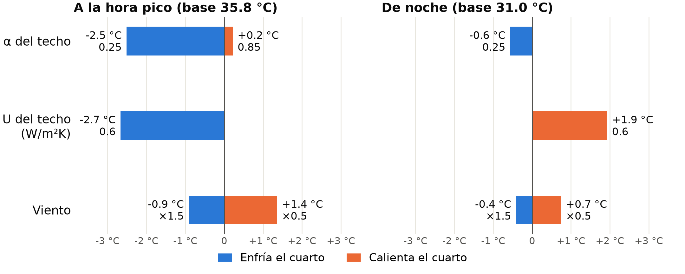

# Médico del Cuarto

Asistente web con IA para hogares sin aire acondicionado. La persona describe su cuarto
conversando, como si le hablara a un vecino, y el asistente le dice qué tan caliente queda,
de dónde viene el calor y qué puede hacer, con las soluciones ordenadas por costo y los grados
que baja cada una.

Proyecto final de Física (Ingeniería de Sistemas).

**Regla de oro: los números salen del motor físico, nunca de la IA.** La IA solo conversa, arma
la ficha del cuarto, llama al motor y explica lo que el motor calculó.

## Qué hace

1. Conversa y arma la ficha del cuarto: medidas, techo, paredes, aberturas, personas y aparatos.
2. Consulta el pronóstico del día en [Open-Meteo](https://open-meteo.com/). Si falla, usa un día
   típico de Barranquilla y lo avisa.
3. Simula 24 horas de la temperatura interior.
4. Muestra un semáforo de confort, la temperatura a la hora pico, cuánto aporta cada fuente de
   calor, la curva del día y un plano con el recorrido del aire.
5. Propone mejoras gratis, de bajo costo y mayores. Cada una se recalcula con el motor, y las
   que implican subirse al techo o tocar la estructura llevan una advertencia de seguridad.

## Instalación

Requiere Python 3.11 o superior.

```bash
python -m venv .venv
```

En Windows se activa con `.venv\Scripts\activate`; en Linux o macOS, con `source .venv/bin/activate`.

```bash
pip install -r requirements.txt
```

Copia `.env.example` como `.env` y llena la clave del proveedor que vayas a usar:

| Variable | Valor |
|---|---|
| `PROVEEDOR_IA` | `gemini` o `claude` |
| `MODELO_IA` | Vacío = el modelo por defecto de ese proveedor |
| `GEMINI_API_KEY` / `ANTHROPIC_API_KEY` | Solo hace falta la del proveedor elegido |

El archivo `.env` nunca se sube a GitHub. El clima no necesita clave.

## Uso

```bash
streamlit run app.py
```

```bash
pytest -q
```

```bash
python sensibilidad.py
```

El último comando regenera `docs/sensibilidad.csv`, `docs/sensibilidad.md` y `docs/sensibilidad.png`.

## Estructura

```
medico_cuarto/
  materiales.py   constantes y tablas (U, alfa, SHGC, calor de aparatos)
  ficha.py        modelos Pydantic: Cuarto, Techo, Pared, Abertura
  clima.py        Open-Meteo + día típico de respaldo
  solar.py        posición del sol y radiación sobre cada superficie
  ventilacion.py  caudal por viento, chimenea y ventilador
  termico.py      ganancias de calor + simulación RC de 24 h
  confort.py      índice de calor y semáforo
  diagnostico.py  aporte de cada fuente en °C
  mejoras.py      catálogo de mejoras + antes/después
  plano.py        dibujo del cuarto con el recorrido del aire
  agente.py       prompt, extracción de la ficha y function calling
  proveedores/    un adaptador por IA (Gemini, Claude)
app.py            interfaz Streamlit
sensibilidad.py   análisis de sensibilidad para la presentación
tests/            pruebas con pytest
docs/             tabla y gráfica de sensibilidad, guion de la demo
```

## La física

Todo está en unidades SI; las temperaturas de confort van en °C.

### Ventilación (caudal Q en m³/s)

| Mecanismo | Fórmula |
|---|---|
| Viento local | `U = U10 · 0.35` (barrio denso; el pronóstico es a 10 m de altura) |
| Viento cruzado | `Q = Cd · A_ef · U · √ΔCp`, con `Cd = 0.6`, `ΔCp = 0.5` y `1/A_ef² = 1/A₁² + 1/A₂²` |
| Viento, una abertura | `Q = 0.025 · A · U` |
| Chimenea, dos aberturas | `Q = Cd · A_ef · √(2 · g · Δh · \|Ti − To\| / Ti)`, con T en kelvin |
| Chimenea, una abertura | `Q = (Cd · A / 3) · √(g · H · \|ΔT\| / T)` |
| Combinación | `Q = √(Q_viento² + Q_chimenea²)`, con un mínimo de 0.5 cambios de aire por hora |
| Ventilador en la ventana | `Q = max(Q_natural, 0.30)`; aporta 50 W |
| Extractor eólico | `Q += 0.08` |

Una puerta que da a un pasillo con salida cuenta al 50 % de su área. De noche, cada ventana o
puerta deja pasar aire solo si la persona dijo que queda abierta; calados y rejillas no se cierran.

### Ganancias de calor (W)

- Temperatura sol-aire: `T_sa = T_ext + α · I / h_o`, con `h_o = 20 W/m²K`. Al techo se le restan
  4 K por radiación hacia el cielo.
- Techo y paredes que dan afuera: `q = U · A · (T_sa − Ti)`. Las paredes interiores solo aportan masa.
- Ventana: `q = SHGC · factor_protección · A · I_vertical`.
- Sol sobre una pared: `I = DNI · max(0, cos θ) + DHI · 0.5 + GHI · 0.2 · 0.5`.
- Calor interno: 75 W por persona, más los aparatos. Los bombillos prenden de 18 h a 23 h.

### Simulación de 24 horas (modelo RC de un nodo)

```
C · dTi/dt = Σ U·A·(T_sa − Ti) + ρ·c·Q·(To − Ti) + P_internas + P_ventanas
C = ρ·c·V + (área de muros y piso) · 0.05 m · 1.8e6 J/m³K
```

Se integra con Euler explícito, con paso de 300 s. El mismo día se repite 3 veces y se reporta
el último. Las pruebas comprueban que el día 3 difiere menos de 0.1 °C de una corrida de 15 días.

### Confort

La presión de vapor adentro es la de afuera, así que
`HR_in = HR_out · es(T_out) / es(T_in)`, con la fórmula de Magnus. La sensación térmica es el
índice de calor de NOAA (Rothfusz).

| Semáforo | Índice de calor |
|---|---|
| 🟢 fresco | menos de 27 °C |
| 🟡 aceptable | de 27 a 32 °C |
| 🟠 caluroso | de 32 a 41 °C |
| 🔴 peligroso | más de 41 °C |

El ventilador apuntando a las personas no cambia la temperatura del aire: solo baja la sensación
térmica unos 2.5 °C, y se muestra aparte.

### Diagnóstico y mejoras

- **Diagnóstico:** se simula quitando una fuente a la vez. Lo que baja la temperatura a la hora
  pico es el aporte de esa fuente.
- **Mejoras:** cada una modifica una copia de la ficha y se vuelve a simular. Se reportan los
  grados que baja a la hora pico y en las horas de dormir.

## Análisis de sensibilidad

Sobre el cuarto de ejemplo (`cuarto_ejemplo()` en `ficha.py`: 3 × 3 m, zinc sin cielo raso, dos
personas, ventana a la calle y puerta a un pasillo) y el día típico de Barranquilla. Se cambia
un parámetro a la vez. La base da 35.8 °C a la hora pico y 31.0 °C de noche.



| Parámetro | Rango | Efecto en el pico | Efecto en la noche |
|---|---|---|---|
| α del techo | 0.25 a 0.85 (base 0.80) | de −2.5 a +0.2 °C | de −0.6 a 0.0 °C |
| U del techo | 0.6 a 6.5 W/m²K (base 6.5) | hasta −2.7 °C | hasta **+1.9 °C** |
| Viento | ×0.5 a ×1.5 | de +1.4 a −0.9 °C | de +0.7 a −0.4 °C |

Tabla completa: [docs/sensibilidad.md](docs/sensibilidad.md).

Dos lecturas para la presentación:

- **Aislar sin ventilar de noche traslada el calor a la madrugada.** Con U = 0.6 W/m²K y todo
  cerrado de noche, el momento más caliente pasa de las 2 p. m. a las 6 a. m. El cuarto no puede
  soltar por el techo lo que guardó, ni el calor de las personas.
- **Pintar el techo es casi tan efectivo como aislarlo a la hora pico** (2.6 °C contra 2.9 °C),
  es una mejora de bajo costo y no calienta la noche.

El "cambio en el pico" compara el máximo de cada corrida, aunque ocurra a otra hora. Por eso, con
U = 0.6 da −2.7 °C, mientras que la mejora de cielo raso (medida a la misma hora de antes) da −2.9 °C.

## Supuestos

**Del modelo, para todos los cuartos:**

- El aire del cuarto está bien mezclado y tiene una sola temperatura.
- El viento local es el 35 % del viento a 10 m.
- Los valores de U, α y SHGC son típicos de tabla, no medidos en cada casa.
- Solo 5 cm de muros y piso guardan calor en un día.
- Personas y aparatos sueltan calor las 24 horas; solo los bombillos tienen horario.
- La humedad de adentro viene del vapor de afuera; no se suma la de personas ni la cocina.
- Si la persona no sabe los puntos cardinales: mañana = este, tarde = oeste, mediodía = sur.

**De cada cuarto:** lo que la persona no dijo se llena con un valor típico, se guarda en
`cuarto.supuestos` y se le cuenta al final de la explicación.

**Día típico de respaldo (Barranquilla, 15 de agosto):** de 28 a 32 °C, humedad de 70 a 80 %,
viento de 3.5 m/s y radiación global máxima de 900 W/m².

## Limitaciones

- **No está calibrado con mediciones reales.** Los resultados son estimaciones para comparar
  opciones. Sirven más para ver qué mejora rinde más que para predecir el grado exacto.
- **Un solo nodo.** No hay estratificación, y el techo no tiene temperatura propia ni masa propia.
  El modelo no ve que un cielo raso deje una cámara de aire caliente.
- **Dirección del viento ignorada.** `ΔCp` es fijo, sin importar de dónde sople ni si hay casas al lado.
- **Salto entre regímenes.** Abrir un hueco muy pequeño en otro lado cambia de "una abertura" a
  "cruzada", y el área efectiva queda limitada por ese hueco. A veces el caudal baja; por eso esas
  mejoras se filtran si calientan la hora pico.
- **Sol de mediodía.** Cerca del ecuador el sol pasa casi por encima. En agosto, en Barranquilla,
  va un poco al norte, así que una pared marcada "mediodía" (sur) casi no recibe sol directo.
- **Aberturas.** El SHGC no cambia si la ventana o el postigo están abiertos.
- **Extractor eólico.** Suma un caudal fijo, aunque no haya viento.
- **Un solo día de pronóstico**, repetido. No representa una ola de calor de varios días.
- **Uso de la IA.** Puede entender mal una descripción. Por eso la ficha y los supuestos se le
  devuelven a la persona. Con la cuota gratis de Gemini (unas 20 solicitudes por día y por
  modelo), una conversación puede gastar la mayoría.
- **Seguridad.** Un índice de calor en rojo es una alerta para buscar un lugar más fresco e
  hidratarse. Esta herramienta no reemplaza el consejo médico.

Quedan fuera de alcance: fotos, recordatorios, base de datos, WhatsApp o Telegram y la
calibración con mediciones.
